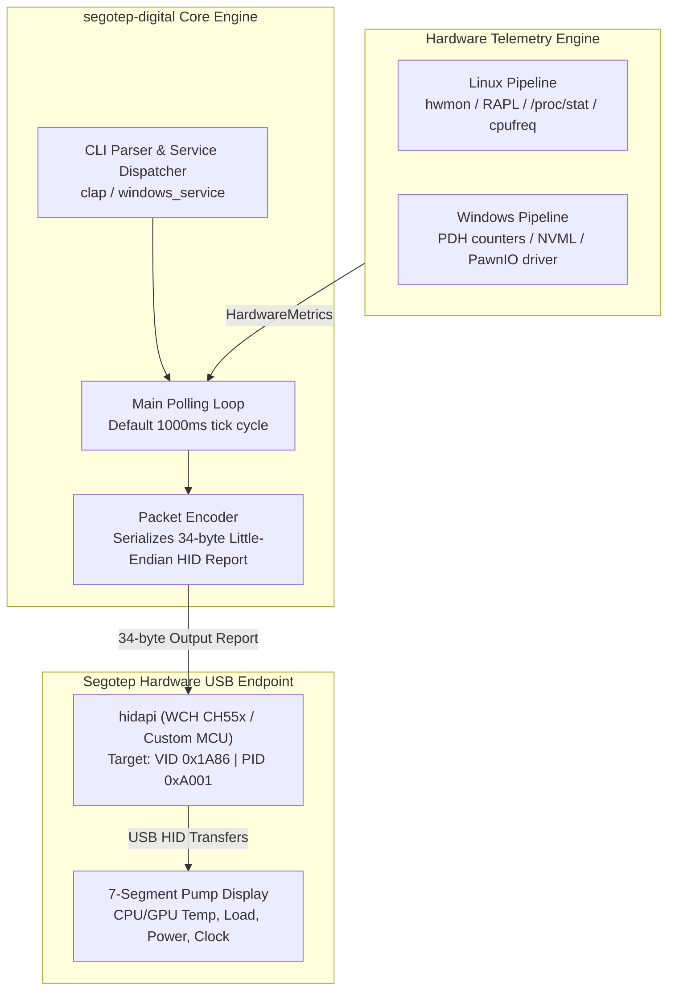

# Architecture & Technical Design

This document describes the internal architecture, cross-platform telemetry pipelines, and USB HID communication flow of `segotep-digital`.

## Overview

`segotep-digital` is a standalone Rust daemon and system service that drives Segotep Digital series AIO liquid cooler screens across Linux and Windows without proprietary vendor utilities.

## Core Components

- **CLI & Service Dispatcher:** Parses CLI flags or hooks directly into the Windows Service Control Manager (SCM) or systemd.
- **Telemetry Engine:** Collects hardware metrics across platforms:
  - **Linux:** Reads sysfs (`hwmon` for temperatures, RAPL energy counters for wattage, `/proc/stat` for load, `cpufreq` for core frequency).
  - **Windows:** Queries PDH counters, NVIDIA NVML for GPU metrics, and talks to the signed PawnIO driver for direct CPU die temperature.
- **Packet Serializer:** Encodes sampled telemetry into a fixed 34-byte report with framing bytes (`0xDC 0xDD`) and little-endian metrics.
- **HID Transport:** Dispatches output reports to USB HID endpoint `1a86:a001` and sends a power-down packet (`0x0E`) on graceful exit.

## Protocol Anatomy

The display expects a 34-byte output report:
- **Bytes 0-2:** Report ID (`0x00`) followed by magic framing bytes `0xDC 0xDD`.
- **Byte 3:** State byte (`0x00` active refresh, `0x0E` screen off).
- **Byte 4:** Model ID (`1` for standard digital coolers, `3` for Ice Moon 360, `0x0F` when powered off).
- **Bytes 13 & 17:** Protocol framing constants `0x01` and `0x0C`.
- **Bytes 21-32:** CPU/GPU temperature, load percentage, little-endian 16-bit power (W), and clock (MHz).
- **Byte 33:** Temperature unit (`0x00` for Celsius, `0x01` for Fahrenheit).

## Invariants & Guarantees

- **Safe Teardown:** Signal handlers and service stop hooks send a screen-off packet (`0x0E`) so the 7-segment display blanks instead of freezing on old data.
- **Zero Unsigned Drivers:** On Windows, HVCI and Core Isolation remain active because CPU thermal queries run via the signed PawnIO driver.
- **Hotplug Resilience:** USB disconnections and reconnects are handled gracefully in the main loop without process termination.
